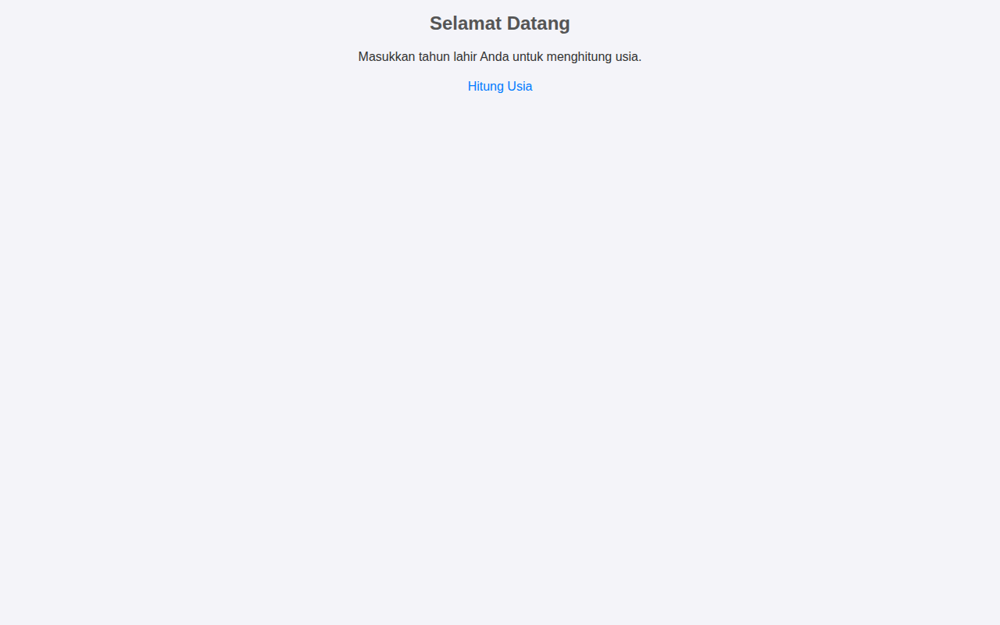

# website-ai-groq

Repositori ini berisi aplikasi web sederhana berbasis Flask. Halaman utama menampilkan sambutan dan tautan ke fitur hitung usia. Pengunjung memasukkan tahun lahir pada formulir, lalu aplikasi menghitung dan menampilkan usia pada tahun berjalan.

## Fitur

- Halaman utama dengan tautan ke fitur hitung usia
- Formulir hitung usia berdasarkan tahun lahir
- Hasil perhitungan usia ditampilkan di halaman yang sama
- Template Jinja dengan satu berkas CSS statis
- Konfigurasi Docker untuk menjalankan aplikasi dalam container

## Teknologi

- Python 3.10
- Flask 2.3.2
- HTML dan CSS
- Docker

## Cara Instalasi

Prasyarat:

- Python 3.10 atau lebih baru
- pip

Langkah instalasi:

1. Clone repositori ini.
2. Masuk ke folder proyek lalu jalankan `pip install -r requirements.txt`.

Aplikasi ini tidak membutuhkan variabel environment dan tidak memakai database.

## Cara Menjalankan

```bash
python main.py
```

Aplikasi berjalan di `http://localhost:5000`. Halaman hitung usia berada di alamat `/usia`.

Menjalankan dengan Docker:

```bash
docker build -t website-ai-groq .
docker run -p 5000:5000 website-ai-groq
```

## Tangkapan Layar



## Lisensi

Proyek ini memakai lisensi MIT. Lihat berkas [LICENSE](LICENSE).
